# ⚡ 1) Install & run

### 📱 Termux (Android) Quick Install & Auto-Update:

```
curl -fsSL https://raw.githubusercontent.com/w8bdcr-official/W8BDCR-OmniRoute-Own/main/install.sh | bash
```

> 💡 Tip: To update on Termux anytime, run `omniroute-update`.

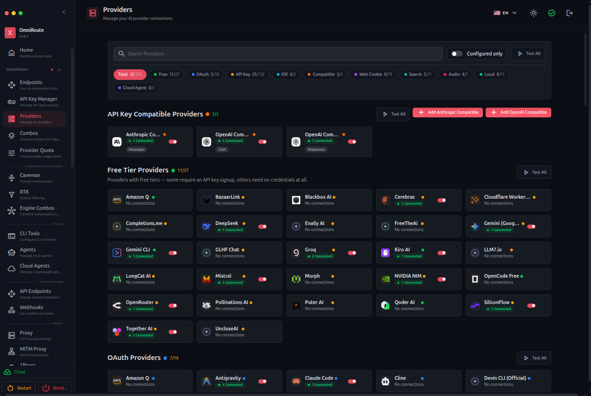

# 🚀 W8BDCR OmniRoute — The Free AI Gateway


### 💰 ~1.51B Free Tokens / Month

Your free-token usage is shown live on your own dashboard after install. The ~1.51B/month figure is the upstream gateway catalog total (pool dedupe, credit tiers, provider terms — re-audited every two weeks, moves both ways as providers end or add free tiers).


### ⭐ Star the repo if W8BDCR OmniRoute helped you

 

### 💬 Join the community

[](https://t.me/BDCRTEAM) [](https://t.me/BDCRTEAM) [](https://t.me/BDCRTEAM) [](https://w8bdcr.de5.net)

Questions, provider tips, roadmap & support → [@BDCRTEAM](https://t.me/BDCRTEAM) · [@w8bdcrteam](https://youtube.com/@w8bdcrteam) · @w8bdcraibot · @w8appstorebot

## 📈 The Gateway Keeps Growing

|  | v3.8.49 | **v3.8.50** | `v3.8.51+` |
|---|---|---|---|
| 🌐 Providers | 290 | **352** | more queued |
| 🧠 Unique chat model IDs | 1185 | **1312** | — |
| 🖼️ Modality Bridge | — | 🆕 vision + audio + video | — |
| 📡 Radar free catalog | — | 🆕 opt-in | — |
| ⚖️ Quota-aware scheduling | — | 🆕 Quota-Share | — |
| 📊 Quota telemetry | — | 🆕 live | — |

**→ Roadmap — riding the rail to `v3.9.0 LTS`**

*Note: these are the upstream gateway's version numbers, shown for reference — your own dashboard shows your install's live numbers.*

## 🧭 Available

   

 

| **🚀 Start** | Quick Start | 📦 Install | 🆓 Zero-config |
|---|---|---|---|
| **💡 Learn** | 💥 The Promise | 🤔 Why OmniRoute | 🏆 What Sets Apart |
| **⚙️ Features** | 🎯 Combos | 🌐 Providers | 🔌 CLI & MCP |
|  | 🗜️ Compression | 🖥️ Where It Runs | 🔒 Private |
| **👀 See it** | 🎬 In Action | ✨ What's New | 🤖 Compatible CLIs |
| **💚 Support** | 💚 Support / Donate | 💬 Community | 💖 Sponsors |
| **📦 Project** | 🛠️ Tech Stack | 📖 Docs | 👥 Contributors |

<div align="center">
  <b>🌐 In 43 languages</b>
  <br><br>
  
  
  
  
  
  
  
  
  
  
  
  
  
  
  
  
  
  
  
  
  
  
  
  
  
  
  
  
  
  
  
  
  
  
  
  
  
  
</div>

## 🆓 Works the second you install it — no keys, no config


```
curl http://localhost:20128/v1/chat/completions -H "Content-Type: application/json" -d '{"model":"auto","messages":[{"role":"user","content":"Hello!"}]}'
```

# 💥 The Promise


# 🤔 Why OmniRoute?



## 🤝 Supported by our Open Source Friends

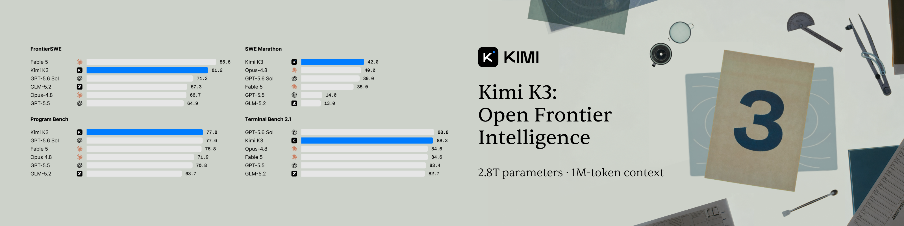

Want to join as an Open Source Friend? These are the companies that back open source and help keep OmniRoute moving.

<table>
  <tr>
    <td align="center" width="150">
      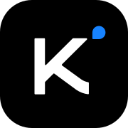
      <br><b>Kimi</b><br><sub>Moonshot AI</sub><br><br>
      
    </td>
    <td>
      Thanks to <b>Kimi (Moonshot AI)</b>, our founding Open Source Friend, for backing this project! Kimi is the AI lab behind the open-weight K2 and K3 model families — <b>Kimi K3</b> delivers a 1M-token context window, native vision and frontier-level coding at a fraction of closed-model prices, and works out of the box with Claude Code, Codex and every coding tool OmniRoute serves.
      <br><br>
      <b>What Kimi's support powers:</b> Kimi's API credits power OmniRoute's AI-validated release pipeline — the <i>merge validation powered by Kimi K3</i> stage that reviews every pull request before it ships — plus day-to-day feature development. First-class Kimi support ships on both rails: the direct <b>Kimi API</b> (<code>kimi-k3</code>) and the <b>Kimi Code coding plan</b> (OAuth and API key). OmniRoute is also the first Brazilian open-source project in Kimi's support program. <b>Get a Kimi API key with 15% extra credits →</b>
    </td>
  </tr>
  <tr>
    <td align="center" width="150">
      
      <br><b>Cheaper Inference</b><br><sub>cheaperinference.com</sub><br><br>
      
    </td>
    <td>
      Thanks to <b>Cheaper Inference</b>, an OmniRoute Open Source Friend, for backing this project! Cheaper Inference is a cost-ranked gateway that resells 42 frontier models — Claude 5.x, Gemini, Kimi K3, GLM, DeepSeek, Grok and MiniMax — behind one OpenAI-compatible endpoint, routing each request to the cheapest eligible provider without ever charging above the model maker's list price.
      <br><br>
      <b>First-class support in OmniRoute:</b> Chat Completions, the native <code>/v1/responses</code> endpoint, vision, tool calling and 3 image models (grok-imagine, nano-banana-pro, nano-banana-2), reachable as <code>cheaperinference/&lt;model&gt;</code>. <b>Get an API key →</b>
    </td>
  </tr>
</table>

### Affiliates Promo — free signup coupons from providers

| Provider | Offer |
|---|---|
<table>
  <tr>
    <td align="center" width="120">
      
      <br><b>AgentRouter</b><br><sub>agentrouter.org</sub>
    </td>
    <td><b>AgentRouter</b> — affiliate signup: <b>$100 free credits</b> on signup (free server, expect higher latency) — best for testing, not production. First-class support in OmniRoute since v3.8.50. Chat Completions, the Anthropic-compatible wire format and the OpenAI-compatible path. Available models include claude-opus-4-8, claude-opus-5, gpt-5.6-sol and more. <b>Grab your $100 →</b><br><br>⚠️ Affiliate link — OmniRoute has no sponsorship or partnership with this provider.</td>
  </tr>
</table>

## 🎯 Combos — The Flagship


### ⚡ Zero-config — just use auto

Call model `auto` and let the gateway pick a healthy free backend.

### 🔀 Or build your own — 19 routing strategies

priority · fill-first · weighted · round-robin · p2c · least-used · random · strict-random · cost-optimized · headroom · reset-window · reset-aware · context-relay · context-optimized · cache-optimized · lkgp · auto · fusion · pipeline

Strategies include auto, fallback, cheapest-first, fastest-first, quality-first and more — full list in the dashboard.

### 🧱 Resilience is built in (3 independent layers)


## 🏆 What Sets OmniRoute Apart


## 💚 Support OmniRoute

OmniRoute is MIT-licensed and maintained in the open. If it saves you time or money, here's how to keep it independent — pick whatever fits you. Sponsorship never affects routing priority; it buys visibility, not ranking.


**📱 Scan to contact @W8BDCR directly on Telegram** — point your camera at the QR code and it opens a chat with us.

| Way to support | What it is | Link |
|---|---|---|
| ⭐ **Star the repo** | Free — genuinely helps visibility | [Star W8BDCR-OmniRoute-Own](https://github.com/w8bdcr-official/W8BDCR-OmniRoute-Own) |
| 💬 **Telegram channel** | Updates, new tools and video links — scan the QR or tap | [@BDCRTEAM](https://t.me/BDCRTEAM) |
| 🤝 **Sponsorship / partnership** | Want to back the project? Message us on Telegram | [@W8BDCR](https://t.me/W8BDCR) |
| 🌐 **Website** | All W8BDCR projects in one place | [w8bdcr.de5.net](https://w8bdcr.de5.net) |

No payment numbers are published here — support is via Star and Telegram only.

<br clear="right">

🐛 Found a bug or have feedback? Open a Discussion.

## 📡 OmniRoute Radar

Radar catalog and free-tier tracking, when enabled in the dashboard.

## ✨ What's New

Recent highlights from **v3.8.20 → v3.8.50**. Full history in `CHANGELOG.md`.

- **🎛️ OmniConductor** — inbound A2A delegation to your agent fleet, Conductor skills on the Agent Card, and a dashboard panel with Faro push-to-talk voice chat.
- **🛂 Adaptive admission & overload protection** — heavyweight chat requests queue instead of 503ing, with atomic RPM rolling leases per connection.
- **🗂️ Canonical `/v1/models` ordering** — one contiguous provider-grouped block per provider (combos pinned first), stable across every catalog source.
- **🗜️ Compression hardening** — default-on inflation guard, Caveman packs for DE / FR / JA + Chinese (wényán), RTK filters for Gradle & .NET.
- **💸 Honest flat-rate cost** — subscription / coding-plan providers read **$0** in cost analytics; budget, quota & routing keep estimating.
- **⚖️ Quota-Share routing** — split a shared account's quota fairly across pooled keys, work-conserving so idle slices are lent out.
- **🤖 One-command CLI/agent setup** — 12 registered `setup-*` commands; `omniroute run` launches 7 CLIs; `omniroute configure` supports 9 targets with an interactive provider+model picker.
- **🛰️ Remote mode** — drive a remote OmniRoute with scoped tokens (`connect` / `contexts` / `tokens`) + an `antigravity` OAuth helper for VPS installs.
- **🧭 Smarter auto-routing** — `auto/<category>:<tier>` combos, **Fusion** (model panel + judge), task-aware routing, per-request model / mode / USD-budget overrides.
- **🗜️ Pluggable compression** — 12 composable engines + Compression Studios: LLMLingua-2, two-tier Ultra, omniglyph, per-step fidelity gate, GCF v3.2, drag-reorder editor.
- **🕵️ Transparent MITM decrypt (TPROXY)** — capture CLIs that ignore proxy env vars, with a per-SNI CA + trust-store installer.
- **💸 Cost telemetry everywhere** — `X-OmniRoute-*` cost/usage headers on every endpoint, cache-HIT savings header, per-key USD spend quotas.

## 🤖 Compatible CLIs & Coding Agents

One config — `http://localhost:20128/v1` — and every AI IDE or CLI runs on free & low-cost models.

<div align="center">
<table>
  <tr>
    <td align="center" width="76"><br><sub><b>Claude Code</b></sub><br><sub>&nbsp;</sub></td>
    <td align="center" width="76"><br><sub><b>Codex CLI</b></sub><br><sub>&nbsp;</sub></td>
    <td align="center" width="76"><br><sub><b>Cline</b></sub><br><sub>&nbsp;</sub></td>
    <td align="center" width="76"><br><sub><b>Kilo Code</b></sub><br><sub>&nbsp;</sub></td>
    <td align="center" width="76"><br><sub><b>Zoo Code</b></sub><br><sub>&nbsp;</sub></td>
    <td align="center" width="76">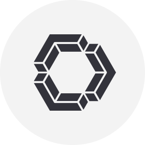<br><sub><b>Continue</b></sub><br><sub>&nbsp;</sub></td>
  </tr>
  <tr>
    <td align="center" width="76"><br><sub><b>Aider</b></sub><br><sub>&nbsp;</sub></td>
    <td align="center" width="76"><br><sub><b>ForgeCode</b></sub><br><sub>&nbsp;</sub></td>
    <td align="center" width="76"><br><sub><b>jcode</b></sub><br><sub>&nbsp;</sub></td>
    <td align="center" width="76"><br><sub><b>DeepSeek TUI</b></sub><br><sub>&nbsp;</sub></td>
    <td align="center" width="76"><br><sub><b>CodeWhale</b></sub><br><sub>&nbsp;</sub></td>
    <td align="center" width="76"><br><sub><b>OpenCode</b></sub><br><sub>&nbsp;</sub></td>
  </tr>
  <tr>
    <td align="center" width="76"><br><sub><b>Factory Droid</b></sub><br><sub>&nbsp;</sub></td>
    <td align="center" width="76"><br><sub><b>GitHub Copilot CLI</b></sub><br><sub>&nbsp;</sub></td>
    <td align="center" width="76"><br><sub><b>Cursor CLI</b></sub><br><sub>&nbsp;</sub></td>
    <td align="center" width="76"><br><sub><b>Smelt</b></sub><br><sub>&nbsp;</sub></td>
    <td align="center" width="76"><br><sub><b>Pi (pi-coding-agent)</b></sub><br><sub>&nbsp;</sub></td>
    <td align="center" width="76"><br><sub><b>Grok Build (xAI)</b></sub><br><sub>&nbsp;</sub></td>
  </tr>
  <tr>
    <td align="center" width="76"><br><sub><b>Hermes Agent (Nous Research)</b></sub><br><sub>&nbsp;</sub></td>
    <td align="center" width="76"><br><sub><b>OpenClaw</b></sub><br><sub>&nbsp;</sub></td>
    <td align="center" width="76"><br><sub><b>Goose</b></sub><br><sub>&nbsp;</sub></td>
    <td align="center" width="76"><br><sub><b>Open Interpreter</b></sub><br><sub>&nbsp;</sub></td>
    <td align="center" width="76"><br><sub><b>Warp AI</b></sub><br><sub>&nbsp;</sub></td>
    <td align="center" width="76"><br><sub><b>Agent Deck</b></sub><br><sub>&nbsp;</sub></td>
  </tr>
</table>
</div>

**+ also works with:** Kiro · Command Code · Antigravity · Windsurf · AMP · **any OpenAI-compatible tool**

Per-tool setup for all 35 tools (26 CLI Codes + 9 CLI Agents).

Launch any supported CLI through OmniRoute in one command — no config files written, credentials injected through process:

```bash
omniroute run claude   --model openai/gpt-5.4      # Claude Code
omniroute run codex    --model glm/glm-5.2         # OpenAI Code
omniroute run aider    --model glm/glm-5.2 --message "reply OK"
omniroute run goose    --model glm/glm-5.2
omniroute run opencode --model glm/glm-5.2 -- run "reply OK"
omniroute run qwen     --model glm/glm-5.2 -p "reply OK"
omniroute run gemini   --model glm/glm-5.2 --skip-trust -p "reply OK"

# Or pick provider+model interactively and write the tool's own conf
omniroute configure codex   # also: claude opencode qwen aide
```

| ZCode | Roo Code | Crush | Qwen Code | Cursor | Antigravity |
|---|---|---|---|---|---|
| Hermes | Kiro | Custom CLI | Oh My Pi | Letta CLI | Prime Agent |


## 🧠 Unique Models — Theirs + W8BDCR Picks

### Theirs — from the upstream gateway catalog (352 providers)

| Category | Providers |
|---|---|
| No-auth (no key required) | AI Horde, Augment (Auggie CLI), Chipotle Pepper AI, Cloudflare AI Playground, OpenAI Codex (App-Server), Devin CLI Agentic Bridge, DuckDuckGo AI Chat, Felo, OpenCode Free, The Old LLM, UncloseAI, Veo AI Free (video), ZCode (GLM Coding Plan) |
| OAuth (sign in, no API key) | Antigravity CLI, Amazon Q, Claude Code, Cline, ClinePass, CodeBuddy CN, OpenAI Codex, Cursor IDE, Devin CLI, GitHub Copilot, GitLab Duo, Grok Build, Kilo Code, Kimi Code CLI, Kiro AI, Openference, Qoder, Raycast Pro AI, Trae, xAI OAuth (Grok), Zed IDE, Zed Hosted Models |
| Free-tier standouts | Kilo Gateway Auto Free (NVIDIA Nemotron 3 family, StepFun, Poolside, Nex-N2-Pro), OpenCode Zen (6 rotating free coding models), Z.AI GLM-4-Flash / 4.5-Flash / 4.7-Flash (permanently free), Arcee Trinity Large (262K context), Cerebras gpt-oss-120b / glm-4.7 (1M tokens/day), Groq llama-3.1-8b-instant / llama-3.3-70b-versatile, Mistral Free Experiment tier |

### W8BDCR Picks — unique models we researched for this build

| Model | Why it's unique | Best for |
|---|---|---|
| DeepSeek V3.2 / R1 | Open-weight reasoning, 128K context, strong code + math | Coding, reasoning |
| Qwen3-235B / Qwen3-Max | Massive open-weight, multilingual, agentic tool use | Agents, multilingual |
| Kimi K2 / K3 Thinking | 1M-token context, native vision, frontier coding | Long docs, coding |
| GLM-4.6 / 4.7 | Z.AI flagship, long context, agentic coding | Coding agents |
| MiniMax M2 | Open-weight, huge context, cheap inference | Long context, chat |
| Llama 4 Maverick | Meta open-weight, multimodal, 1M context | Vision, chat |
| Gemma 3 (27B) | Google open-weight, runs on one GPU, multimodal | Local, vision |
| Phi-4 Reasoning | Microsoft small model, reasoning-first, efficient | Reasoning on low hardware |
| Mistral Small 3.1 | Fast, 128K context, vision, Apache-2.0 | Speed, vision |
| Nemotron 3 Nano / Ultra | NVIDIA open-weight, reasoning, free via Kilo/NVIDIA | Free coding |

*Models resolve live from the dashboard's provider catalog — availability and free quotas change with providers, so the dashboard is the source of truth.*


## 🌐 All Providers — 352 (full catalog)

Every provider in the upstream gateway catalog, grouped by access type. The dashboard at `/dashboard/providers` is the live source — enable, configure and test each one there.

### No-auth (12)

| Provider | ID |
|---|---|
| AI Horde | `aihorde` |
| Augment (Auggie CLI) | `auggie` |
| Chipotle Pepper AI (Free) | `chipotle` |
| Cloudflare AI Playground | `cloudflare-playground` |
| OpenAI Codex (App-Server) | `codex-app-server` |
| Devin CLI Agentic Bridge | `devin-cli-agentic` |
| DuckDuckGo AI Chat | `duckduckgo-web` |
| Felo | `felo-web` |
| OpenCode Free | `opencode` |
| The Old LLM (Free) | `theoldllm` |
| UncloseAI | `uncloseai` |
| ZCode (GLM Coding Plan) | `zcode` |

### OAuth (22)

| Provider | ID |
|---|---|
| Antigravity CLI | `agy` |
| Amazon Q | `amazon-q` |
| Claude Code | `claude` |
| Cline | `cline` |
| ClinePass | `clinepass` |
| CodeBuddy CN | `codebuddy-cn` |
| OpenAI Codex | `codex` |
| Cursor IDE | `cursor` |
| Devin CLI | `devin-cli` |
| GitHub Enterprise Copilot | `ghe-copilot` |
| GitHub Copilot | `github` |
| GitLab Duo | `gitlab-duo` |
| Grok Build | `grok-cli` |
| Kilo Code | `kilocode` |
| Kimi Code CLI | `kimi-coding` |
| Kiro AI | `kiro` |
| Openference | `openference` |
| Qoder | `qoder` |
| Raycast Pro AI | `raycast` |
| Trae | `trae` |
| xAI OAuth (Grok) | `xai-oauth` |
| Zed IDE | `zed` |

### Web cookie (35)

| Provider | ID |
|---|---|
| Adapta.org (Adapta One Web) | `adapta-web` |
| Adobe Firefly (Image/Video) | `adobe-firefly` |
| Blackbox Web (Subscription) | `blackbox-web` |
| ChatGPT Web (Plus/Pro) | `chatgpt-web` |
| ChatGPT Web (Codex) | `chatgpt-web-codex` |
| Claude Web | `claude-web` |
| Conol (Unofficial/Experimental) | `conol-web` |
| Microsoft 365 Copilot (BizChat) | `copilot-m365-web` |
| Microsoft Copilot Web | `copilot-web` |
| DeepSeek Web | `deepseek-web` |
| Dola Web (ByteDance) | `doubao-web` |
| Gemini Business (Enterprise) | `gemini-business` |
| Gemini Web (Free) | `gemini-web` |
| Grok Web (Subscription) | `grok-web` |
| Hailuo Web (MiniMax) | `hailuo-web` |
| HuggingChat (Free) | `huggingchat` |
| HyperAgent (Unofficial/Experimental) | `hyperagent` |
| Inner.ai (Subscription) | `inner-ai` |
| Kimi Web | `kimi-web` |
| Arena (Free) | `lmarena` |
| Microsoft Designer (Image Generation) | `microsoft-designer-web` |
| Muse Spark Web (Meta AI) | `muse-spark-web` |
| Notion AI Web (Unofficial/Experimental) | `notion-web` |
| Perplexity Web (Pro/Max) | `perplexity-web` |
| Poe Web (Subscription) | `poe-web` |
| PromptQL (Unofficial/Experimental) | `promptql` |
| Qwen Web (Free) | `qwen-web` |
| t3.chat (Pro/Free) | `t3-web` |
| Tencent AI Studio (Free) | `tencent-aistudio-web` |
| TinyCMS Web (Free/Sub) | `tinycms-web` |
| v0 Vercel Web (Code Gen) | `v0-vercel-web` |
| Venice Web (Privacy) | `venice-web` |
| Tencent Yuanbao (Free) | `yuanbao-web` |
| Z.ai Web | `zai-web` |
| ZenMux Free (Web) | `zenmux-free` |

### API key (150)

| Provider | ID |
|---|---|
| 360 AI | `360ai` |
| AI21 Labs | `ai21` |
| AINative Studio | `ainative` |
| Aion Labs | `aion` |
| Alibaba Cloud Model Studio | `alibaba` |
| Alibaba (China) | `alibaba-cn` |
| Ant Ling / Ring (inclusionAI) | `ant-ling` |
| Anthropic | `anthropic` |
| Api.airforce | `api-airforce` |
| Arcee AI | `arcee-ai` |
| b.ai | `bai` |
| Baichuan | `baichuan` |
| Baidu (ERNIE) | `baidu` |
| Alibaba Token Plan | `bailian-coding-plan` |
| Baseten | `baseten` |
| BazaarLink | `bazaarlink` |
| Blackbox AI | `blackbox` |
| BluesMinds | `bluesminds` |
| BytePlus ModelArk | `byteplus` |
| Bytez | `bytez` |
| Cerebras | `cerebras` |
| Charm Hyper | `charm-hyper` |
| Cheaper Inference | `cheaperinference` |
| Chenzk API | `chenzk` |
| Cloudflare Workers AI | `cloudflare-ai` |
| Naver CLOVA Studio | `clova-studio` |
| Codestral | `codestral` |
| Cohere | `cohere` |
| Command Code | `command-code` |
| Coze | `coze` |
| CrofAI | `crof` |
| Cursor API | `cursor-api` |
| Dahl | `dahl` |
| DeepInfra | `deepinfra` |
| DeepSeek | `deepseek` |
| DGrid | `dgrid` |
| Dify | `dify` |
| DigitalOcean | `digitalocean` |
| DIT.ai | `dit` |
| Doubao | `doubao` |
| Factory | `factory` |
| Featherless AI | `featherless-ai` |
| Fireworks AI | `fireworks` |
| FreeAIAPIKey | `freeaiapikey` |
| Freebuff | `freebuff` |
| FreeModel.dev | `freemodel-dev` |
| FriendliAI | `friendliai` |
| Galadriel | `galadriel` |
| Gemini (Google AI Studio) | `gemini` |
| GigaChat (Sber) | `gigachat` |
| GitLab Duo PAT | `gitlab` |
| Gitlawb Opengateway (MiMo) | `gitlawb` |
| Gitlawb Opengateway (GMI Cloud) | `gitlawb-gmi` |
| GLM Coding | `glm` |
| GLM Coding (China) | `glm-cn` |
| GLM Thinking | `glmt` |
| Groq | `groq` |
| Huancheng Public API | `hcnsec` |
| HuggingFace | `huggingface` |
| Hyperbolic | `hyperbolic` |
| Ideogram | `ideogram` |
| iFlytek Spark | `iflytek` |
| Inception | `inception` |
| Inference.net | `inference-net` |
| InternLM (Intern-S1) | `internlm` |
| Jina Reader (r.jina.ai) | `jina-reader` |
| Kenari | `kenari` |
| KIE.AI | `kie` |
| Kimi (Legacy Moonshot API) | `kimi` |
| Kimi Code API Key | `kimi-coding-apikey` |
| Lambda AI | `lambda-ai` |
| Liquid AI | `liquid` |
| LlamaGate | `llamagate` |
| LLM7.io | `llm7` |
| LongCat AI | `longcat` |
| Maritalk | `maritalk` |
| Meta Llama API | `meta-llama` |
| Minimax (China) | `minimax-cn` |
| Mistral | `mistral` |
| Mixedbread AI | `mixedbread` |
| ModelScope | `modelscope` |
| MonsterAPI | `monsterapi` |
| Kimi | `moonshot` |
| Morph | `morph` |
| Muse Code (Meta) | `muse-code` |
| NanoGPT | `nanogpt` |
| NaraRouter | `nara` |
| NavyAI | `navy` |
| Nebius AI | `nebius` |
| NLP Cloud | `nlpcloud` |
| Nomic | `nomic` |
| Nous Research | `nous-research` |
| nScale | `nscale` |
| Nube.sh | `nube` |
| NVIDIA NIM | `nvidia` |
| Ollama Cloud | `ollama-cloud` |
| OpenAdapter | `openadapter` |
| OpenAI | `openai` |
| OpenCode Go | `opencode-go` |
| OpenCode Zen | `opencode-zen` |
| Openference API | `openference-api` |
| OpenVecta | `openvecta` |
| OrcaRouter | `orcarouter` |
| OVHcloud AI | `ovhcloud` |
| Perplexity | `perplexity` |
| Pioneer AI | `pioneer` |
| PLaMo | `plamo` |
| Poolside | `poolside` |
| Predibase | `predibase` |
| PublicAI | `publicai` |
| Baidu Qianfan | `qianfan` |
| Qiniu | `qiniu` |
| Qwen Cloud | `qwen-cloud` |
| Qwen Cloud Token Plan | `qwen-cloud-token-plan` |
| Regolo AI | `regolo` |
| Reka | `reka` |
| Requesty | `requesty` |
| Routeway | `routeway` |
| SambaNova | `sambanova` |
| Sarvam AI | `sarvam` |
| Scaleway AI | `scaleway` |
| SEA-LION | `sealion` |
| SenseNova | `sensenova` |
| SiliconFlow | `siliconflow` |
| SparkDesk | `sparkdesk` |
| StepFun | `stepfun` |
| SumoPod | `sumopod` |
| Suno | `suno` |
| Tencent Hunyuan | `tencent` |
| TinyFish Fetch | `tinyfish` |
| Token Kiosk | `token-kiosk` |
| TokenRouter | `tokenrouter` |
| Typhoon | `typhoon` |
| Udio | `udio` |
| Upstage | `upstage` |
| v0 (Vercel) | `v0-vercel` |
| Venice.ai | `venice` |
| Volcengine | `volcengine` |
| Volcengine Ark Agent Plan | `volcengine-agent-plan` |
| Volcengine Ark Coding Plan | `volcengine-coding-plan` |
| Wafer AI | `wafer` |
| Weights & Biases Inference | `wandb` |
| Writer | `writer` |
| X5Lab | `x5lab` |
| xAI (Grok) | `xai` |
| Xiaomi MiMo | `xiaomi-mimo` |
| Xiaomi MiMo Token Plan | `xiaomi-mimo-token-plan` |
| Yi (01.AI) | `yi` |
| Z.AI | `zai` |
| ZenMux | `zenmux` |

### Local (2)

| Provider | ID |
|---|---|
| ComfyUI | `comfyui` |
| SD WebUI | `sdwebui` |

### Search (14)

| Provider | ID |
|---|---|
| Brave Search | `brave-search` |
| Context7 (library docs) | `context7` |
| Exa Search | `exa-search` |
| Firecrawl | `firecrawl` |
| Google Programmable Search | `google-pse-search` |
| Linkup Search | `linkup-search` |
| Ollama Search | `ollama-search` |
| Perplexity Search | `perplexity-search` |
| SearchAPI | `searchapi-search` |
| SearXNG Search | `searxng-search` |
| Serper Search | `serper-search` |
| Tavily Search | `tavily-search` |
| X Search (Grok) | `x-search` |
| You.com Search | `youcom-search` |

### Audio (12)

| Provider | ID |
|---|---|
| AssemblyAI | `assemblyai` |
| AWS Polly | `aws-polly` |
| Cartesia | `cartesia` |
| Deepgram | `deepgram` |
| ElevenLabs | `elevenlabs` |
| Fish Audio | `fishaudio` |
| Gladia | `gladia` |
| Inworld | `inworld` |
| PlayHT | `playht` |
| Rev AI | `rev-ai` |
| Soniox | `soniox` |
| Speechmatics | `speechmatics` |

### Upstream proxy (2)

| Provider | ID |
|---|---|
| 9router | `9router` |
| CLIProxyAPI | `cliproxyapi` |

### Cloud agent (3)

| Provider | ID |
|---|---|
| Codex Cloud | `codex-cloud` |
| Devin | `devin` |
| Google Jules | `jules` |

### System (1)

| Provider | ID |
|---|---|
| Auto (Zero-Config) | `auto` |

## 🌐 AI Providers

### 🏢 Every major lab — through one endpoint

<div align="center">
<table>
  <tr>
    <td align="center" width="76"><br><sub><b>OpenAI</b></sub><br><sub>&nbsp;</sub></td>
    <td align="center" width="76"><br><sub><b>Anthropic</b></sub><br><sub>&nbsp;</sub></td>
    <td align="center" width="76"><br><sub><b>Gemini</b></sub><br><sub>&nbsp;</sub></td>
    <td align="center" width="76"><br><sub><b>xAI Grok</b></sub><br><sub>&nbsp;</sub></td>
    <td align="center" width="76"><br><sub><b>DeepSeek</b></sub><br><sub>&nbsp;</sub></td>
    <td align="center" width="76"><br><sub><b>Mistral</b></sub><br><sub>&nbsp;</sub></td>
  </tr>
  <tr>
    <td align="center" width="76"><br><sub><b>Qwen</b></sub><br><sub>&nbsp;</sub></td>
    <td align="center" width="76"><br><sub><b>Meta Llama</b></sub><br><sub>&nbsp;</sub></td>
    <td align="center" width="76"><br><sub><b>Groq</b></sub><br><sub>&nbsp;</sub></td>
    <td align="center" width="76"><br><sub><b>NVIDIA</b></sub><br><sub>&nbsp;</sub></td>
    <td align="center" width="76"><br><sub><b>MiniMax</b></sub><br><sub>&nbsp;</sub></td>
    <td align="center" width="76"><br><sub><b>Cohere</b></sub><br><sub>&nbsp;</sub></td>
  </tr>
  <tr>
    <td align="center" width="76"><br><sub><b>Perplexity</b></sub><br><sub>&nbsp;</sub></td>
    <td align="center" width="76"><br><sub><b>HuggingFace</b></sub><br><sub>&nbsp;</sub></td>
    <td align="center" width="76"><br><sub><b>Together</b></sub><br><sub>&nbsp;</sub></td>
    <td align="center" width="76"><br><sub><b>Fireworks</b></sub><br><sub>&nbsp;</sub></td>
    <td align="center" width="76"><br><sub><b>Cloudflare</b></sub><br><sub>&nbsp;</sub></td>
    <td align="center" width="76"><br><sub><b>Baidu</b></sub><br><sub>&nbsp;</sub></td>
  </tr>
</table>
</div>

…and 330+ more — every one resolves live from the dashboard's provider catalog.


### 🆓 Free Forever — $0, no card

<div align="center">
<table>
  <tr>
    <td align="center" width="76"><br><sub><b>OpenCode Zen</b></sub><br><sub>DeepSeek V4, Nemotron 3, No token cap</sub></td>
    <td align="center" width="76"><br><sub><b>Kilo Code</b></sub><br><sub>Auto-router, Tencent Hy3, Free forever</sub></td>
    <td align="center" width="76"><br><sub><b>Requesty</b></sub><br><sub>GPT-OSS 120B, Nemotron, Free forever</sub></td>
    <td align="center" width="76"><br><sub><b>SiliconFlow</b></sub><br><sub>DeepSeek V3.2 / R1, Free tier</sub></td>
    <td align="center" width="76"><br><sub><b>Z.AI GLM</b></sub><br><sub>GLM-4.7 / 4.5-Flash, Free tier</sub></td>
    <td align="center" width="76"><br><sub><b>Baidu ERNIE</b></sub><br><sub>ERNIE 4.0, Free forever</sub></td>
  </tr>
  <tr>
    <td align="center" width="76"><br><sub><b>Qoder AI</b></sub><br><sub>Qwen3-Max, Kimi-K2, Unlimited FREE</sub></td>
    <td align="center" width="76"><br><sub><b>Pollinations</b></sub><br><sub>GPT, Llama, Claude, No key needed</sub></td>
    <td align="center" width="76"><br><sub><b>Cloudflare AI</b></sub><br><sub>50+ models, 10K neurons/day</sub></td>
    <td align="center" width="76">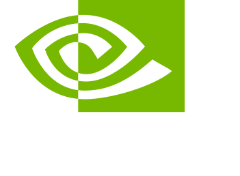<br><sub><b>NVIDIA NIM</b></sub><br><sub>GLM, MiniMax, ~40 RPM free</sub></td>
    <td align="center" width="76"><br><sub><b>Cerebras</b></sub><br><sub>GLM 4.7, GPT-OSS, 1M tokens/day</sub></td>
    <td align="center" width="76"><br><sub><b>OpenRouter</b></sub><br><sub>Free models, +$10 — higher RPM</sub></td>
  </tr>
</table>
</div>


Full machine-readable catalog → `docs/reference/PROVIDER_REFERENCE.md`

## 🖥️ Where OmniRoute Runs — Anywhere

| Platform | Install | Highlights |
|---|---|---|
| 📦 npm (global) | `npm install -g omniroute` | One command, any OS |
| 🐳 Docker | `docker run diegosouzapw/omniroute` | Multi-arch AMD64 + ARM64 |
| 🖥️ Desktop (Electron) | `npm run electron:build` | Native window + system tray — Windows / macOS / Linux |
| 💪 ARM | `native arm64` | Raspberry Pi, ARM servers, Apple Silicon |
| 📱 Android (Termux) | `pkg install nodejs && npx -y omniroute` | Runs on your phone, 24/7, no root |
| 📲 PWA | `Add to Home Screen` | Fullscreen, offline, installable from browser |
| 🧩 OpenCode plugin | `@omniroute/opencode-provider` | Native OpenCode integration |
| 🤖 VS Code Copilot Chat | `install OmniCopilot extension` | Every OmniRoute model in the native Copilot Chat picker — stable & Insiders |
| 🛠️ From source | `npm install && npm run dev` | Hack on it, contribute |

### 🧩 New: OmniRoute inside VS Code's native Copilot Chat

Point VS Code Copilot Chat at http://localhost:20128/v1.

## 🔒 Private & Local-First


## 🔌 Full CLI + A2A & MCP


### ⌨️ A real CLI (not just start)

`omniroute serve`, `omniroute --version`, `omniroute-update` on Termux.

### 🛰️ Remote mode — run the CLI here, OmniRoute on a VPS

Run the CLI locally, point it at a remote gateway URL.

### 🤝 Connect an agent — and it controls OmniRoute itself

Agents can call the gateway API to manage routing from inside a session.

Give Claude Code the full OmniRoute toolset over MCP:

```bash
claude mcp add-server omniroute --type http --url http://localhost:20128/api/mcp/stream
```

## 🗜️ Save 15–95% Tokens — Automatically


### 📖 How it works — pipeline, architecture & savings math

Compression, fallback and routing happen inside the gateway; savings depend on the workload and provider.

Default stacked combo runs `RTK → Caveman`. When both act on the same tool/context payload, savings compound:

```
combined = 1 − (1 − RTK) × (1 − Caveman_input)
average  = 1 − (1 − 0.80) × (1 − 0.46) = 89.2%
range    = 78.4 – 94.6%
```

An illustrative 10,000-token client request passes through 12 composable engines — Session-Dedup, CCR, Lite, RTK, Responses Tool Output, Headroom, Relevance, Caveman, Aggressive, LLMLingua-2, Ultra and OmniGlyph — and can reach the provider at about 1,080 tokens. Code blocks, URLs, JSON and structured data are **always protected** by the preservation engine.

### 🧱 The 12-engine stack

Compression engines are listed in the gateway docs; savings depend on workload and provider.

### 🎚️ Beyond the engines — output styles, the adaptive dial & per-request control

Per-request controls are set in the dashboard and in the request body.

# ⚡ Quick Start

## 📦 More install methods — Docker, source, pnpm, Arch

**🐳 Docker**

```bash
docker run -d --name omniroute --restart unless-stopped --stop-timeout 40 \
  -p 127.0.0.1:20128:20128 -v omniroute-data:/app/data diegosouzapw/omniroute:latest
```

`:latest` follows the highest **published** stable SemVer. It does not track git `main`. Pin `:X.Y.Z` for GitOps. The image pins **`OMNIROUTE_MEMORY_MB=1024`**. That is enough for the dashboard and a light chat. **Coding agents** need a much larger V8 heap:

| Workload | Heap (`-e OMNIROUTE_MEMORY_MB`) | Container (`--memory`) |
|---|---|---|
| Dashboard / light chat | `1024` (image default) | ≥2 g |
| One coding agent | `8192` | ≥10 g |
| Two concurrent long `/v1/responses` | `10240`–`12288` | ≥12–16 g |

```bash
docker run -d --name omniroute --restart unless-stopped --stop-timeout 40 \
  -e OMNIROUTE_MEMORY_MB=8192 --memory=10g \
  -p 127.0.0.1:20128:20128 -v omniroute-data:/app/data diegosouzapw/omniroute:latest
```

> **Pre-release Docker channel:** `diegosouzapw/omniroute:next` and `diegosouzapw/omniroute:next-web` follow the current default `release/v*` branch. These mutable tags are intended only for testing unreleased fixes and are **not supported for production**.

**🥟 Bun**

```bash
# Install and run with Bun
bun install
bun run dev
```

**🛠️ From source**

```bash
cp .env.example .env && npm install
PORT=20128 npm run dev
```

**📦 pnpm**

```bash
pnpm add -g omniroute@latest --allow-build=better-sqlite3 --allow-build=@swc/core && omniroute
```

**🐧 Arch Linux (AUR)**

```bash
yay -S omniroute-bin && systemctl --user enable --now omniroute.service
```

**🔧 Nix (Flake)**

```bash
# Using Nix flakes
nix develop
npm run dev

# Or using devbox
devbox run npm run dev
```

**🦭 Podman**

```bash
# 1. Prepare the bind-mounted data directory
mkdir -p data

# 2. Linux + local rootless Podman only (never a remote Podman Machine client)

# 3. Set the runtime hint, build the local Compose image, and start
```

### ⚡ Faster / leaner install (skip the native build)

The native SQLite engine (`better-sqlite3`) is an **optional** dependency, so a global install never blocks on compiling from source.

```
OMNIROUTE_SKIP_POSTINSTALL=1 npm install -g omniroute   # CI=1 also skips it
```

For the fastest installs prefer **pnpm**. For a dashboard-free, headless runtime use the Docker `base` profile or the Termux guide.

# 🎬 OmniRoute in Action

## 📹 Video Guides

| #1 | #2 | #3 | #4 | #5 |
|---|---|---|---|---|
| nick_saraev — Instagram — **3,042,474** | theopenstack — Instagram — **692,419** | milesreevesai — TikTok — **620,400** | Vaibhav Sisinty — YouTube — **391,109** | buildwithai.club — Instagram — **347,652** |
| #6 | #7 | #8 | #9 | #10 |
|---|---|---|---|---|
| nivedan.ai — Instagram — **331,973** | vaibhavsisinty — Instagram — **263,744** | Nick Automates — YouTube Shorts — **218,174** | theroshankrishna — Instagram — **186,786** | midudev — TikTok — **177,800** |

Metrics (2026-08-24): **1,029 unique videos · 11,132,922 views · 639 channels/profiles per network**. The raw panel holds 1,070 lines; 41 duplicates were normalized by canonical URL, keeping the highest count per video.

Made a video about OmniRoute? Open an issue with the link — we'll feature it here. W8BDCR's own demo videos will be added here as they are published.

# 📧 Community & Help

| Channel | Where / how |
|---|---|
| 💬 Telegram — W8BDCR community | https://t.me/BDCRTEAM |
| 🎬 YouTube — W8BDCR team | https://youtube.com/@w8bdcrteam |
| 🤖 Telegram bot | @w8bdcraibot |
| 🛒 Telegram app store bot | @w8appstorebot |
| 🐙 GitHub | https://github.com/w8bdcr-official |
| 📦 Source code | https://github.com/w8bdcr-official/W8BDCR-OmniRoute-Own |
| 🐛 Report a bug | Open an issue on the repo |
| 🤝 Contribute | See CONTRIBUTING.md |
| 💚 Support the project | See Support section above |

## 🛠️ Tech Stack

| Layer | Stack |
|---|---|
| Installer | bash, Node.js, npm |
| Gateway | Upstream open-source package (installed via npm) |
| Dashboard | Web dashboard at http://localhost:20128 |
| Termux | pkg, nodejs, git, esbuild |
| CI/CD | GitHub Actions |

## 📖 Documentation

| Doc | Where |
|---|---|
| Getting Started | README Install & Quick Start |
| Operations & Deployment | docs/guides/ |
| Features & Architecture | docs/ |
| Protocols & APIs | /v1 API, MCP, A2A |
| Project & Quality | CONTRIBUTING.md, CHANGELOG.md, LICENSE |

### 📘 Getting Started

Start with Install & run, then Quick Start.

### 🔧 Operations & Deployment

Docker, Termux, VPS and update notes are in `docs/guides/`.

### 🧠 Features & Architecture

Features, routing and compression notes are in `docs/`.

### 🤖 Protocols & APIs

OpenAI-compatible `/v1` API, plus MCP and A2A where enabled.

### 📋 Project & Quality

Contributing, changelog and licence notes are in the repo root.

# ⭐ Top Contributors

| Contributor | Role |
|---|---|
| W8BDCR | Installer, updater, uninstaller, README |

### External contributors by merged pull requests

Listed from merged pull requests to this installer repo.

### GitHub-attributed commits

Listed from GitHub commit attribution for this repo.

## 💖 Sponsors

A heartfelt thank-you to the people who fund OmniRoute out of their own pocket — every contribution keeps the project free, independent and moving.

| Andrew | Vlad I | Paco Cartones | Prof. Igor Morais | longtao |
|---|---|---|---|---|
| 💛 Active monthly sponsor | 💛 Active monthly sponsor | 💛 Active one-time sponsor | 💛 Past one-time supporter | 💛 Past one-time supporter |

…and others who prefer to stay private 💛

Public GitHub Sponsors revalidated on 2026-08-24. GitHub's `activeOnly` status determines the active labels above; previously disclosed public one-time supporters remain thanked, and private sponsors remain anonymous.

💖 **[Become a sponsor](https://github.com/sponsors/w8bdcr-official)** — every dollar keeps OmniRoute free and independent.

*These are the upstream gateway's public sponsors, shown for reference — W8BDCR's own sponsor slots are open.*

## 👥 600+ Contributors

[](https://github.com/diegosouzapw/OmniRoute/graphs/contributors)

Audited on 2026-08-24 at frozen base and rechecked at live release tip: **639 normalized human Git identities** — 407 appear as commit authors (including the maintainer) and 232 only in explicit co-authored-by trailers.

*Upstream gateway's contributor grid, shown for reference — this installer repo's own contributors are listed below.*

| Contributor | Role |
|---|---|
| W8BDCR | Installer, updater, uninstaller, README |

### How to Contribute

1. Fork the repository
2. Branch from the active `release/vX.Y.Z` tip (not `main`) — see Branching & Release Model
3. Create your feature branch (`git checkout -b feat/amazing-feature`)
4. Commit your changes (`git commit -m 'feat: add amazing feature'`)
5. Push to the branch (`git push origin feat/amazing-feature`)
6. Open a Pull Request with `base` = that `release/vX.Y.Z` branch

See CONTRIBUTING.md for detailed guidelines.

### Releasing a New Version

```
# Create a release — npm publish happens automatically
VERSION=x.y.z
gh release create "v${VERSION}" --title "v${VERSION}" --generate-notes
```

## 📊 Stars

[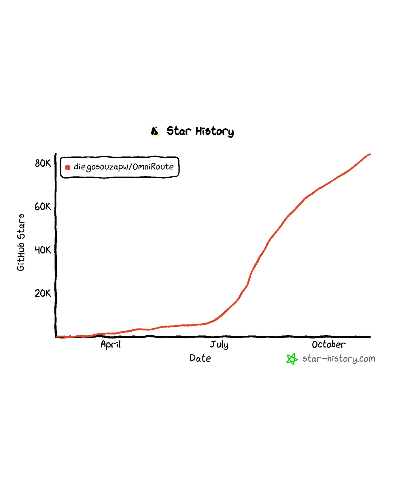](https://www.star-history.com/?repos=w8bdcr-official%2FW8BDCR-OmniRoute-Own&type=date)

Star history chart supplied by the user for reference — this repo's own star chart will replace it once it has stars of its own.

## 🌍 StarMapper

[](https://starmapper.bruniaux.com/diegosouzapw/omniroute)

*Upstream OmniRoute StarMapper map, shown for reference — W8BDCR's own map will be generated from this repo's own stargazers once it has stars.*

## 🙏 Acknowledgments

The gateway is upstream open-source software. The projects below are acknowledged as inspirations for OmniRoute, as in the upstream README — listed here by name and link, with their public star counts at the time of checking.

### 🧬 Lineage & gateway

| Project | ⭐ | Note |
|---|---|---|
| [9router](https://github.com/decolua/9router) | 26,161 | Acknowledged inspiration for OmniRoute |
| [CLIProxyAPI](https://github.com/router-for-me/CLIProxyAPI) | 48,497 | Acknowledged inspiration for OmniRoute |
| [LiteLLM](https://github.com/BerriAI/litellm) | 57,100 | Acknowledged inspiration for OmniRoute |
| [codex-chatgpt-web](https://github.com/miuuyy/codex-chatgpt-web) | 1,410 | Acknowledged inspiration for OmniRoute |
| [free-claude-code](https://github.com/Alishahryar1/free-claude-code) | 48,112 | Acknowledged inspiration for OmniRoute |
| [composer-api](https://github.com/standardagents/composer-api) | 322 | Acknowledged inspiration for OmniRoute |
| [codex-multi-auth](https://github.com/ndycode/codex-multi-auth) | 457 | Acknowledged inspiration for OmniRoute |
| [opencode-anthropic-auth](https://github.com/ex-machina-co/opencode-anthropic-auth) | 510 | Acknowledged inspiration for OmniRoute |
| [grok2api-merged](https://github.com/520mmxx/grok2api-merged) | 2 | Acknowledged inspiration for OmniRoute |
| [TQZHR/grok2api](https://github.com/TQZHR/grok2api) | 705 | Acknowledged inspiration for OmniRoute |
| [chenyme/grok2api](https://github.com/chenyme/grok2api) | 7,520 | Acknowledged inspiration for OmniRoute |
| [grok2api-pro](https://github.com/miuzhaii/grok2api-pro) | 27 | Acknowledged inspiration for OmniRoute |
| [GrokProxy](https://github.com/CNFlyCat/GrokProxy) | 50 | Acknowledged inspiration for OmniRoute |
| [GrokBridge](https://github.com/lianying1716/GrokBridge) | 5 | Acknowledged inspiration for OmniRoute |
| [grok-web-api](https://github.com/imjustprism/grok-web-api) | 14 | Acknowledged inspiration for OmniRoute |

### 🗜️ Context & token compression — engines

| Project | ⭐ | Note |
|---|---|---|
| [Caveman](https://github.com/JuliusBrussee/caveman) | 100,538 | Acknowledged inspiration for OmniRoute |
| [RTK – Rust Token Killer](https://github.com/rtk-ai/rtk) | 77,185 | Acknowledged inspiration for OmniRoute |
| [headroom](https://github.com/headroomlabs-ai/headroom) | 67,310 | Acknowledged inspiration for OmniRoute |
| [LLMLingua](https://github.com/microsoft/LLMLingua) | 6,598 | Acknowledged inspiration for OmniRoute |
| [llmlingua-2-js](https://github.com/atjsh/llmlingua-2-js) | 31 | Acknowledged inspiration for OmniRoute |
| [Troglodita](https://github.com/leninejunior/troglodita) | 40 | Acknowledged inspiration for OmniRoute |
| [ponytail](https://github.com/DietrichGebert/ponytail) | 108,957 | Acknowledged inspiration for OmniRoute |
| [i-have-adhd](https://github.com/ayghri/i-have-adhd) | 23,526 | Acknowledged inspiration for OmniRoute |

### 🧩 Compact formats, token research & code-aware tooling

| Project | ⭐ | Note |
|---|---|---|
| [TOON](https://github.com/toon-format/toon) | 25,233 | Acknowledged inspiration for OmniRoute |
| [GCF – Graph Compact Format](https://github.com/blackwell-systems/gcf) | 41 | Acknowledged inspiration for OmniRoute |
| [gcf-typescript](https://github.com/blackwell-systems/gcf-typescript) | 4 | Acknowledged inspiration for OmniRoute |
| [token-optimizer-mcp](https://github.com/ooples/token-optimizer-mcp) | 494 | Acknowledged inspiration for OmniRoute |
| [token-savior](https://github.com/Mibayy/token-savior) | 1,122 | Acknowledged inspiration for OmniRoute |
| [token-saver](https://github.com/ppgranger/token-saver) | 138 | Acknowledged inspiration for OmniRoute |
| [token-optimizer](https://github.com/alexgreensh/token-optimizer) | 1,951 | Acknowledged inspiration for OmniRoute |
| [TokenMizer](https://github.com/Shweta-Mishra-ai/tokenmizer) | 28 | Acknowledged inspiration for OmniRoute |
| [OmniCompress](https://github.com/jessefreitas/OmniCompress) | 3 | Acknowledged inspiration for OmniRoute |
| [mcp-compressor](https://github.com/atlassian-labs/mcp-compressor) | 113 | Acknowledged inspiration for OmniRoute |
| [RepoMapper](https://github.com/pdavis68/RepoMapper) | 197 | Acknowledged inspiration for OmniRoute |
| [quiet-shell-mcp](https://github.com/mrsimpson/quiet-shell-mcp) | 4 | Acknowledged inspiration for OmniRoute |
| [ts-morph](https://github.com/dsherret/ts-morph) | 6,162 | Acknowledged inspiration for OmniRoute |

### 🧠 Memory & RAG

| Project | ⭐ | Note |
|---|---|---|
| [Mem0](https://github.com/mem0ai/mem0) | 63,902 | Acknowledged inspiration for OmniRoute |
| [Letta (MemGPT)](https://github.com/letta-ai/letta) | 24,382 | Acknowledged inspiration for OmniRoute |
| [WFGY](https://github.com/onestardao/WFGY) | 1,781 | Acknowledged inspiration for OmniRoute |

### 🛰️ Traffic inspection, MITM & transparent proxy

| Project | ⭐ | Note |
|---|---|---|
| [llm-interceptor](https://github.com/chouzz/llm-interceptor) | 66 | Acknowledged inspiration for OmniRoute |
| [ProxyBridge](https://github.com/InterceptSuite/ProxyBridge) | 5,995 | Acknowledged inspiration for OmniRoute |

### 📚 Model data, observability & UI

| Project | ⭐ | Note |
|---|---|---|
| [models.dev](https://github.com/anomalyco/models.dev) | 6,555 | Acknowledged inspiration for OmniRoute |
| [React Flow / xyflow](https://github.com/xyflow/xyflow) | 38,108 | Acknowledged inspiration for OmniRoute |
| [LangGraph](https://github.com/langchain-ai/langgraph) | 40,314 | Acknowledged inspiration for OmniRoute |
| [Langfuse](https://github.com/langfuse/langfuse) | 33,592 | Acknowledged inspiration for OmniRoute |
| [Kiali](https://github.com/kiali/kiali) | 3,631 | Acknowledged inspiration for OmniRoute |
| [lobe-icons](https://github.com/lobehub/lobe-icons) | 2,428 | Acknowledged inspiration for OmniRoute |
| [flag-icons](https://github.com/lipis/flag-icons) | 12,354 | Acknowledged inspiration for OmniRoute |

### 🛡️ Security

| Project | ⭐ | Note |
|---|---|---|
| [awesome-secure-defaults](https://github.com/tldrsec/awesome-secure-defaults) | 721 | Acknowledged inspiration for OmniRoute |

### 🧭 Complementary tools

| Project | ⭐ | Note |
|---|---|---|
| [ClawRouter](https://github.com/BlockRunAI/ClawRouter) | 6,564 | Acknowledged inspiration for OmniRoute |
| [Antigravity-Manager](https://github.com/lbjlaq/Antigravity-Manager) | 30,652 | Acknowledged inspiration for OmniRoute |
| [vscode-antigravity-cockpit](https://github.com/jlcodes99/vscode-antigravity-cockpit) | 4,817 | Acknowledged inspiration for OmniRoute |
| [AionUi](https://github.com/iOfficeAI/AionUi) | 32,230 | Acknowledged inspiration for OmniRoute |
| [CodexBar](https://github.com/steipete/CodexBar) | 20,507 | Acknowledged inspiration for OmniRoute |

## 📄 License

MIT License - see [LICENSE](LICENSE) for details.

---

**[⬆ Back to top](#-w8bdcr-omniroute) · Built with ❤️ for the open-source AI community.**

W8BDCR OmniRoute · Termux · MIT License
