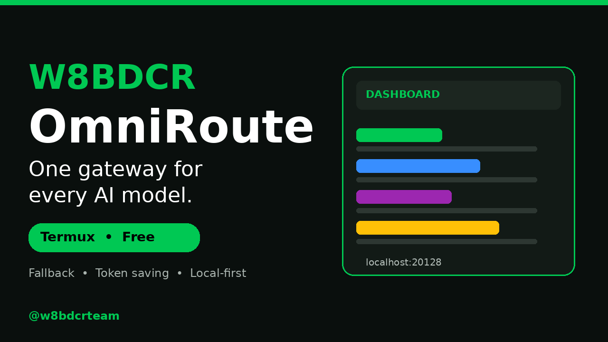
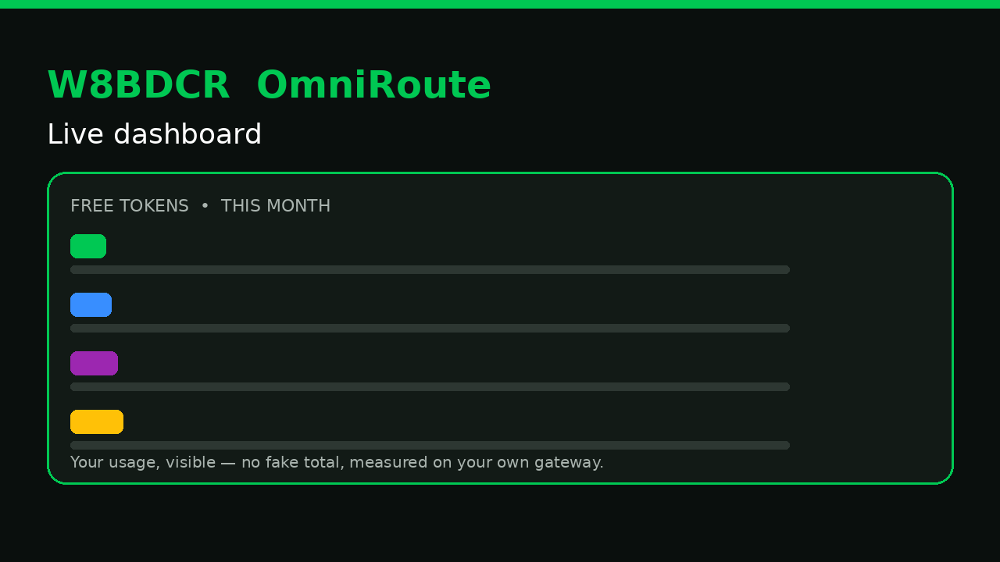

# W8BDCR OmniRoute — Termux AI Gateway

One command on your phone to talk to many AI model providers, with a
fallback when one provider fails and a clear view of how many tokens
you used. Built by W8BDCR, for Termux on Android.

## ⚡ 1) Install & run

### 📱 Termux (Android) Quick Install & Auto-Update:

```bash
curl -fsSL https://raw.githubusercontent.com/w8bdcr-official/W8BDCR-OmniRoute-Own/main/install.sh | bash
```

💡 Tip: To update on Termux anytime, run `omniroute-update`.



## 🚀 W8BDCR OmniRoute — One Gateway for Every AI Model


Start it, then open the dashboard:

```bash
omniroute serve
```

```
http://localhost:20128
```

## 🔥 Free Tokens — Visible on Your Own Dashboard



Your free-token usage is shown live on the dashboard, so you can see
what you actually used. This repo does not print a borrowed total —
the number you see after install is your own gateway's number.

## 🧭 Available

|  |  |  |
| --- | --- | --- |
| 🚀 Start | 📦 Install | ⚡ Quick Start |
| 💡 Learn | ❓ What It Does | ⭐ Why W8BDCR |
| ✨ Features | 🔌 Providers | 🖥️ CLI |
| 🔒 Private | 📚 Docs | 🤝 Community |

## 🛠️ Works the second you install it — no keys, no config


```bash
curl http://localhost:20128/v1/chat/completions \
  -H "Content-Type: application/json" \
  -d '{"model": "auto", "messages": [{"role": "user", "content": "Hello!"}]}'
```

## Quick start — copy, paste, run

No keys and no config are needed for the first test. With the server
running, ask it a question:

```bash
curl http://localhost:20128/v1/chat/completions \
  -H "Content-Type: application/json" \
  -d '{"model": "auto", "messages": [{"role": "user", "content": "Hello!"}]}'
```

Python:

```python
import requests
r = requests.post(
    "http://localhost:20128/v1/chat/completions",
    json={"model": "auto", "messages": [{"role": "user", "content": "Hello!"}]},
)
print(r.json())
```

Node.js:

```javascript
const r = await fetch("http://localhost:20128/v1/chat/completions", {
  method: "POST",
  headers: { "Content-Type": "application/json" },
  body: JSON.stringify({
    model: "auto",
    messages: [{ role: "user", content: "Hello!" }],
  }),
});
console.log(await r.json());
```

Pick a specific provider when you want one, and let the gateway fall
back to another when your first pick fails.

## 🤝 The Promise

You write your tool once, against one local address. The gateway
handles which provider answers, what happens when one fails, and
how much you spent — so you do not rewrite your tool for every new
model or provider.

## ⭐ Why W8BDCR OmniRoute

- **Built for a phone first.** Termux install, Termux update, Termux
  uninstall — no desktop-only steps hidden in the middle.
- **No lock-in.** Change providers by changing config, not by
  rewriting your app.
- **Visible cost.** Usage is on the dashboard, not buried in a bill
  you see at month's end.
- **Local-first.** The gateway runs on your device; your keys stay
  on your device.

## What it does

- **One gateway, many providers.** Point your tools at one local
  address instead of wiring each provider separately.
- **Fallback, not failure.** If the provider you picked is down or
  refuses a request, the gateway can try the next one in your list.
- **Token use you can see.** The dashboard shows usage, so you can
  spot waste and keep costs down.
- **CLI first.** Everything the dashboard does starts from the
  command line, so it fits a Termux workflow.

## 🖥️ Where W8BDCR OmniRoute Runs — Anywhere

Same gateway, your rules. This repo's installer is Termux-first:

| Platform | Install | Highlights |
| --- | --- | --- |
| Android (Termux) | `bash install.sh` in this repo | Runs on your phone, no root |
| npm (global) | `npm install -g omniroute` | One command, any OS |
| Docker | Upstream gateway image | Multi-arch, isolated |
| From source | Upstream repo + `npm install` | Hack on it, contribute |

## 🔒 Private & Local-First

Your keys, your machine, your data. The gateway is a local proxy —
it does not phone home. Keys live in environment variables on your
phone, never in this repo, and never in a screenshot you share.

## 🛠️ Full CLI

Beyond the dashboard, the gateway is a command-line cockpit:

```bash
omniroute serve      # serve gateway + dashboard (port 20128)
omniroute --version  # check the install
omniroute-update     # update from this repo's updater
bash uninstall.sh    # remove it (add --purge for config too)
```

## 💰 Save Tokens — Automatically

The gateway's compression and routing help you spend fewer tokens
for the same answer. The exact saving depends on your prompt and
provider — the dashboard shows your own measured usage, not a
borrowed percentage.

## Providers, privacy, and keys

Providers are configured by you, on your own phone, with your own API
keys in environment variables. This repo contains no keys, no accounts,
and no provider credentials — copy `.env.example` to your own config
and fill in only the providers you actually use.

Your requests go to the providers you chose. Nothing in this installer
sends your keys anywhere else, and the gateway runs locally on your
device.

## How it works, in short

1. `install.sh` installs Node.js, Git and esbuild in Termux.
2. It installs the upstream OmniRoute gateway from npm.
3. It applies Android fixes the phone build needs: browser automation
   is skipped on Android, server binding is guarded, and the local
   database file is linked where the built server expects it.
4. It adds `omniroute-update`, which checks npm, reinstalls when a
   newer version exists, and re-runs the installer so the fixes are
   re-applied.

## 📣 Community & Help

Everything in one place — follow, chat, or open an issue.

| Channel | Where / how |
| --- | --- |
| Telegram channel | @BDCRTEAM |
| YouTube | @w8bdcrteam |
| Bots | @w8bdcraibot, @w8appstorebot |
| Report a bug | Open an issue in this repo |
| Contribute | See CONTRIBUTING.md |

## 🛠️ Tech Stack

| Layer | Technology |
| --- | --- |
| Installer | Bash, Termux `pkg` |
| Gateway runtime | Node.js, npm |
| Dashboard | Upstream gateway web UI, port 20128 |
| This repo's images | PIL (Python), own dashboard mock |
| Platforms | Android (Termux) first, npm/Docker/source as gateway methods |

## 📖 Documentation

### Getting Started

| Document | Description |
| --- | --- |
| README.md | Install, run, quick start, features |
| install.sh | Full Termux install + Android fixes |
| update.sh | Update + re-apply fixes |
| uninstall.sh | Clean removal for all install methods in this repo |

### Operations & Deployment

| Document | Description |
| --- | --- |
| .env.example | Placeholder config, no real keys |
| SECURITY.md | How to report a security problem |
| CONTRIBUTING.md | How to contribute, in W8BDCR's own wording |

## ⚡ Detailed Quick Start

### 1) Install & run

See the Termux Quick Install at the top of this README, then:

```bash
omniroute serve
```

Dashboard: `http://localhost:20128`

### 2) Connect a FREE provider

Dashboard → Providers → connect a free provider → done.

### 3) Point your coding tool

```
Base URL: http://localhost:20128/v1
API Key:  [copy from Dashboard → Endpoints]
Model:    auto
```

### 4) Verify it's working

```bash
curl http://localhost:20128/v1/models -H "Authorization: Bearer YOUR_KEY"
```

You should see your connected models listed. That's it — start
coding, and the gateway auto-routes and falls back for you.

### More install methods — Docker, source, pnpm, Arch, Nix, Podman

These are upstream gateway methods, not this repo's Termux
installer. They work the same way once the gateway is running,
through the same dashboard and the same `localhost:20128` endpoint.
For a phone, use the Termux install at the top — it is the one
this repo tests and fixes.

### Faster / leaner install

On a slow phone or CI, prefer the Termux install in this repo:
it already uses a low-memory fallback and skips nothing you need
for the dashboard. No separate CLI-only package is needed — the
CLI and the dashboard are served by the same process, on one port.

## 🌐 Providers

Every major lab, through one endpoint. Connect a provider once in
the dashboard, then use it from any tool through `localhost:20128`.
The full live catalog is in the dashboard after install — this
repo does not print a borrowed provider count.

## 🆓 Free Forever — $0, no card

Free tiers are visible in the dashboard's free catalog. Connect a
free provider, no signup where the provider allows it, and start
coding. Quotas and limits are the provider's own — check them in
the dashboard before you rely on one.

## 🔀 Combos

A combo is a preset route: which provider answers first, which one
takes over on failure, and how much compression to apply. Pick a
combo in the dashboard, or let smart routing pick for you.

## ⚙️ Zero-config

No keys, no config to start. Model `auto` means the gateway picks
the best available route for your prompt. Add keys later only for
providers you actually want to pay for.

## 🛡️ Resilience

If a provider fails, the gateway retries, cools down, and falls
back to the next route — so one outage does not kill your session.
Fallbacks, retries, and timeouts are configured per combo.

## ⭐ What Sets It Apart

- Local-first, private by default
- One endpoint for every tool
- Visible usage, visible cost
- Termux-first install, update, and uninstall
- No lock-in: change providers by changing config

## 📡 Support

- Report a bug: open an issue in this repo
- Ask a question: @BDCRTEAM on Telegram
- Security problem: see SECURITY.md

## 📈 What's New

- v1.0 — Termux installer, Android fixes, `omniroute-update`
  helper, dashboard verify, uninstaller, W8BDCR README and designs
- Next — more Termux-tested fixes, more dashboard images, more
  guides, based on real phone testing

## 🖥️ Compatible CLIs

Point any OpenAI-compatible coding tool at the gateway:

```
Base URL: http://localhost:20128/v1
API Key:  [copy from Dashboard → Endpoints]
Model:    auto
```

## 🎬 In Action

Video guides for this repo live on @w8bdcrteam. If you made a
video about W8BDCR OmniRoute, share it on @BDCRTEAM and it can be
featured here.

## 👥 Contributors

This repo's contributors start with W8BDCR. Upstream gateway
contributors are not listed here, because their work belongs to
the upstream project — see Acknowledgments below. New
contributors to this installer, docs, and designs are welcome;
see CONTRIBUTING.md.

## ⭐ Stars

Star history for this repo starts when it is posted. This repo
does not borrow another project's star graph.

## 🙏 Acknowledgments

This installer stands on an upstream open-source gateway — the
gateway itself is not W8BDCR's code, and this repo does not claim
it. What is W8BDCR's here is the Termux installer, updater,
uninstaller, documentation, and design images. Thank you to the
upstream gateway's maintainers and contributors for the gateway
itself.

## Documentation index

Files in this repo, in the order GitHub lists them:

- `.env.example` — placeholder config, no real keys
- `CONTRIBUTING.md` — how to contribute
- `install.sh` — the Termux installer
- `LICENSE` — MIT
- `README.md` — this file
- `SECURITY.md` — how to report a security problem
- `thumbnail-draft.png` — dashboard banner image (1280×720)
- `thumbnail-draft-720x1640.png` — same banner, phone-video size
- `uninstall.sh` — removal, with an optional `--purge` for config
- `update.sh` — the updater behind `omniroute-update`

Remove it any time with `bash uninstall.sh` (add `--purge` to also
remove its local config).

## Notes and limits

- Termux on Android only. This installer checks for Termux and stops
  plainly outside it.
- A phone has little memory: the installer retries the npm install
  with a low-memory Node setting if the first attempt fails.
- The gateway itself is upstream open source; this repo is W8BDCR's
  own installer, updater, uninstaller and documentation for it.

## License

MIT — see `LICENSE`. Copyright (c) 2026 W8BDCR.
